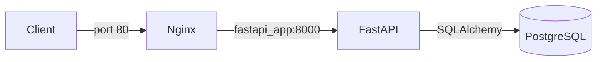

**API REST de gestion d'utilisateurs et de publications (FastAPI)**  
**Introduction**  

---
**Sommaire**  
1. [Structure du projet](#anchor-1 "#anchor-1")  
2. [Architecture FastAPI](#anchor-2 "#anchor-2")  
3. [Base de données](#anchor-3 "#anchor-3")  
4. [Sécurité et authentification](#anchor-4 "#anchor-4")  
5. [Conteneurisation et reverse proxy](#anchor-5 "#anchor-5")  
6. [Outils et standards](#anchor-6 "#anchor-6")  

---
**Structure du projet**  
.  
 ├── main.py              # Les endpoints de l'API  
 ├── models.py            # Modèles SQLAlchemy (tables)  
 ├── schemas.py           # Schémas Pydantic (validation)  
 ├── database.py          # Connexion à PostgreSQL et get_db()  
 ├── config.py            # Lecture des variables d'environnement  
 ├── utils.py             # Hachage des mots de passe et création du JWT  
 ├── oauth2.py            # Vérification du token et get_current_user()  
 ├── requirements.txt     # Dépendances Python  
 ├── dockerfile           # Image Docker de l'API  
 ├── docker-compose.yml   # Orchestration des conteneurs  
 ├── nginx/  
 │   └── default.conf     # Configuration du reverse proxy  
 ├── alembic.ini          # Configuration des migrations  
 └── alembic/             # Scripts de migration 



---
**1. Architecture FastAPI**  
*Conception d'une API REST organisée autour de ressources (utilisateurs, publications), avec validation des données par Pydantic et gestion des erreurs par codes de statut HTTP.*  
Dans une API REST, l'URL désigne **la ressource** et la méthode HTTP désigne **l'action**. Les endpoints sont déclarés dans main.py avec des décorateurs comme @app.get("/users/{id}").  

| Ressource | URL | Méthodes |
|---|---|---|
| Utilisateurs | /users | POST, GET |
| Utilisateurs | /users/{id} | GET, PATCH, DELETE |
| Utilisateurs | /users/{id}/posts | GET, DELETE |
| Utilisateurs | /users/me | GET (protégée) |
| Publications | /posts | POST (protégée), GET |
| Publications | /posts/{id} | GET, PATCH et DELETE (protégées) |
| Authentification | /login | POST |

Les données envoyées par le client sont validées par les schémas Pydantic avant d'arriver dans la route. Les mêmes schémas contrôlent aussi la sortie : UserResponse ne contient pas le mot de passe, donc il n'est jamais renvoyé au client.  
class UserCreate(BaseModel):  
     username: str = Field(..., min_length=3)  
     email: EmailStr  
     password: str = Field(..., min_length=6)  
     age: int = Field(None, ge=18)  

Si les données sont invalides, FastAPI répond automatiquement avec une erreur **422**. Pour les autres cas, on lève une **HTTPException** avec le bon code : 401 (non authentifié), 403 (interdit), 404 (introuvable), 409 (email déjà utilisé). La création d'un utilisateur renvoie 201 et lance une tâche en arrière-plan (BackgroundTasks) qui simule l'envoi d'un email de bienvenue.  

---
**2. Base de données**  

*Modélisation relationnelle avec **SQLAlchemy** sous PostgreSQL, séparation entre modèles de base de données et schémas de validation, et gestion du cycle CRUD à travers des sessions injectées avec Depends.*  

Modèles et schémas : Un modèle SQLAlchemy (models.py) décrit une table de la base. Un schéma Pydantic (schemas.py) décrit les données échangées avec le client. Ils sont séparés : UserModel contient le mot de passe haché, alors que UserResponse ne l'expose pas.  

**SQLAlchemy**: est un ORM, il fait le lien entre les classes Python et les tables

**SQL** : une classe correspond à une table, un objet à une ligne. On écrit donc des requêtes en Python plutôt qu'en SQL.  

Chaque requête HTTP reçoit sa propre session de base de données grâce à une fonction génératrice :  
def get_db():  
     db = SessionLocal()  
     try:  
         yield db  
     finally:  
         db.close()  

Le **yield** prête la session à la route, et le finally la ferme toujours à la fin. Les routes la récupèrent avec db: Session = Depends(get_db).  

**Cycle CRUD** : Les opérations suivent toujours le même schéma :  

| Action | Code utilisé |
|---|---|
| Créer | db.add(), db.commit(), db.refresh() |
| Lire | db.query(Model).filter(...).first() ou .all() |
| Modifier | setattr() sur chaque champ envoyé, puis db.commit() |
| Supprimer | db.delete(), puis db.commit() |


Les utilisateurs ne sont pas supprimés réellement : on passe is_active à False (suppression logique). Les publications sont supprimées définitivement. 

**Relations** : Un utilisateur possède plusieurs publications. Au niveau SQL, la table posts contient la clé étrangère author_id vers users.id. Au niveau Python, relationship avec back_populates permet d'écrire user.posts et post.author.  


---
**3. Sécurité et authentification**  
*Protection des comptes par hachage des mots de passe, authentification sans état par jetons JWT, et politique CORS pour limiter les origines autorisées.*  

**Hachage** : Le mot de passe n'est jamais stocké en clair. La bibliothèque passlib utilise l'algorithme bcrypt pour produire une empreinte (utils.py). À la connexion, on compare le mot de passe saisi avec l'empreinte grâce à verify_password.

**JWT** : L'authentification est stateless : le serveur ne garde aucune session en mémoire. À la connexion (/login), l'API crée un token JWT signé avec la SECRET_KEY, contenant l'identifiant de l'utilisateur et une date d'expiration. Le client renvoie ce token dans l'en-tête Authorization: Bearer à chaque requête.  

**Vérification** : Dans oauth2.py, OAuth2PasswordBearer extrait le token de la requête. La fonction get_current_user le décode, vérifie la signature et l'expiration, puis charge l'utilisateur. Une route est protégée en ajoutant Depends(get_current_user).  

**CORS** : Le middleware CORSMiddleware n'autorise que les origines listées (localhost:3000 par exemple) à appeler l'API depuis un navigateur.  

---
**4. Conteneurisation et reverse proxy**  
*Isolation de la base de données, de l'API et du reverse proxy Nginx dans des conteneurs Docker orchestrés par Docker Compose, au sein d'un réseau interne.*

Le dockerfile construit l'image de l'API (python:3.11-slim, installation du requirements.txt, lancement avec uvicorn). Le fichier docker-compose.yml lance 
trois services : **nginx**, **fastapi_app** et **postgres_db**. Ils partagent un réseau interne où chaque service est joignable par son nom, c'est pourquoi l'API se connecte à la base avec le nom d'hôte postgres_db. Les données de PostgreSQL sont conservées dans un volume (postgres_data), et les secrets sont injectés avec env_file.  

Nginx joue le rôle de reverse proxy : il reçoit les requêtes sur le port 80 et les transmet à l'API, qui n'est donc pas la porte d'entrée directe du serveur.  

```nginx
location / {
    proxy_pass http://fastapi_app:8000;
    proxy_set_header Host $host;
    proxy_set_header X-Real-IP $remote_addr;
}
```

---
**5. Outils et standards**  
*Standards professionnels autour du code : règle de cascade, migrations avec Alembic, inspection avec DBeaver, séparation des responsabilités, fichiers de configuration, et gestion rigoureuse des dépendances logicielles via un fichier de spécification (requirements.txt), garantissant la reproductibilité de l'environnement et la portabilité du système d'un poste de développement à un serveur de production.*  

Règle de cascade. La clé étrangère est déclarée avec ondelete="CASCADE" : si un utilisateur est supprimé de la table users, PostgreSQL supprime automatiquement ses publications, ce qui évite les publications orphelines.

Migrations avec Alembic. Les tables ne sont pas créées par le code mais par des migrations versionnées, comme un Git pour la base de données. Le fichier env.py pointe vers les modèles avec target_metadata = Base.metadata.

```bash
alembic revision --autogenerate -m "creation des tables"
alembic upgrade head
```

Inspection avec DBeaver. DBeaver permet de se connecter à PostgreSQL (localhost, port 5432) pour consulter les tables et vérifier les données, par exemple que le mot de passe est bien haché.  
Séparation des préoccupations. Chaque fichier a une seule responsabilité (configuration, connexion, modèles, schémas, sécurité, routes). Depends relie ces briques : une route déclare ce dont elle a besoin (session, utilisateur connecté) et FastAPI le fournit.  
Fichiers de configuration.  
| | |  
|-|-|
| **Fichier** | **Rôle** |   
| .env | Contient les secrets et paramètres (non publié sur GitHub) |   
| config.py | Lit le .env avec pydantic-settings et vérifie les types |   
| requirements.txt | Liste des dépendances |   
| dockerfile et .dockerignore | Construction de l'image, fichiers exclus |   
| docker-compose.yml | Définition des trois conteneurs |   
| nginx/default.conf | Configuration du reverse proxy |   
| alembic.ini | Configuration des migrations |   

Gestion des dépendances. Le fichier requirements.txt permet de réinstaller exactement le même environnement avec une seule commande, sur n'importe quelle machine ou dans un conteneur.  

```text
fastapi
uvicorn
sqlalchemy
psycopg[binary]
pydantic-settings
pydantic[email]
passlib[bcrypt]
bcrypt==4.0.1
pyjwt
python-multipart
```

---
**Auteur**  
